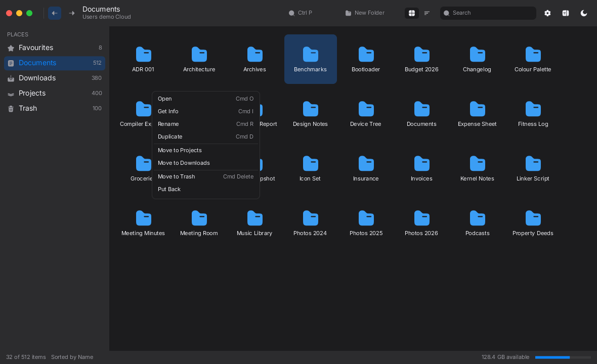
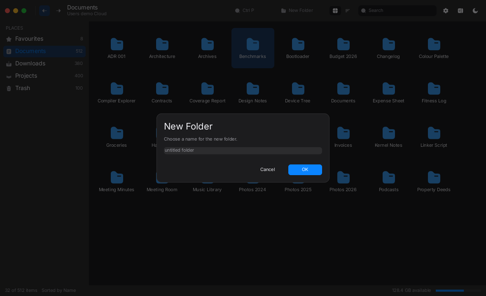
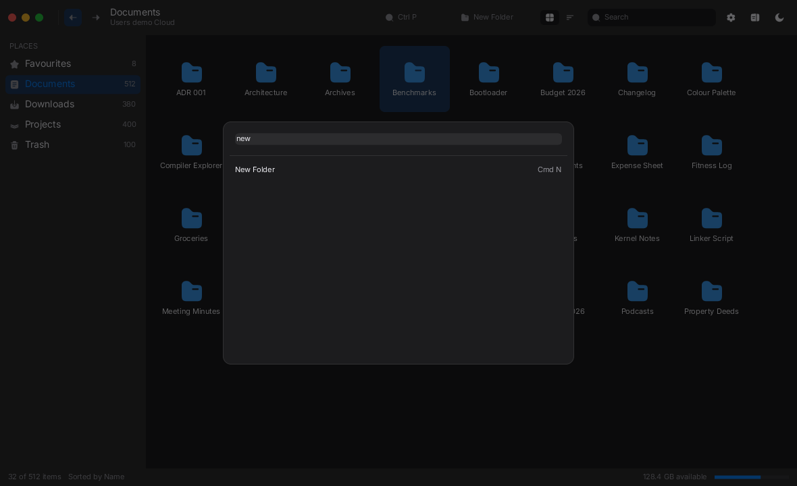
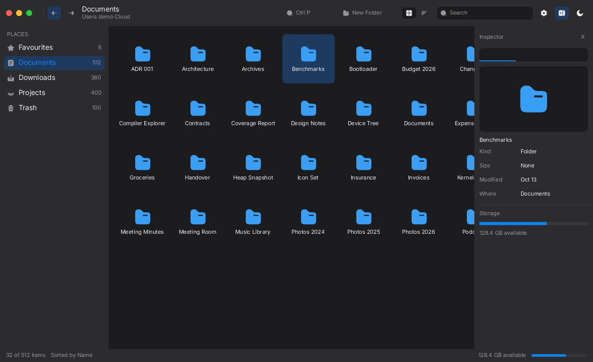
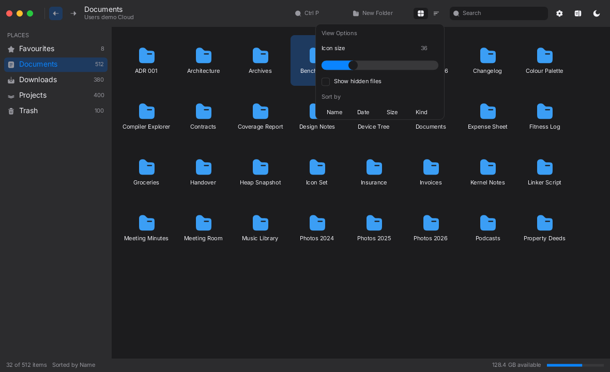
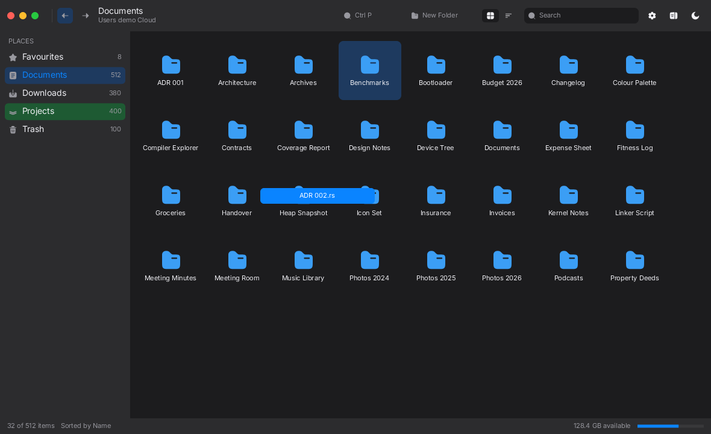
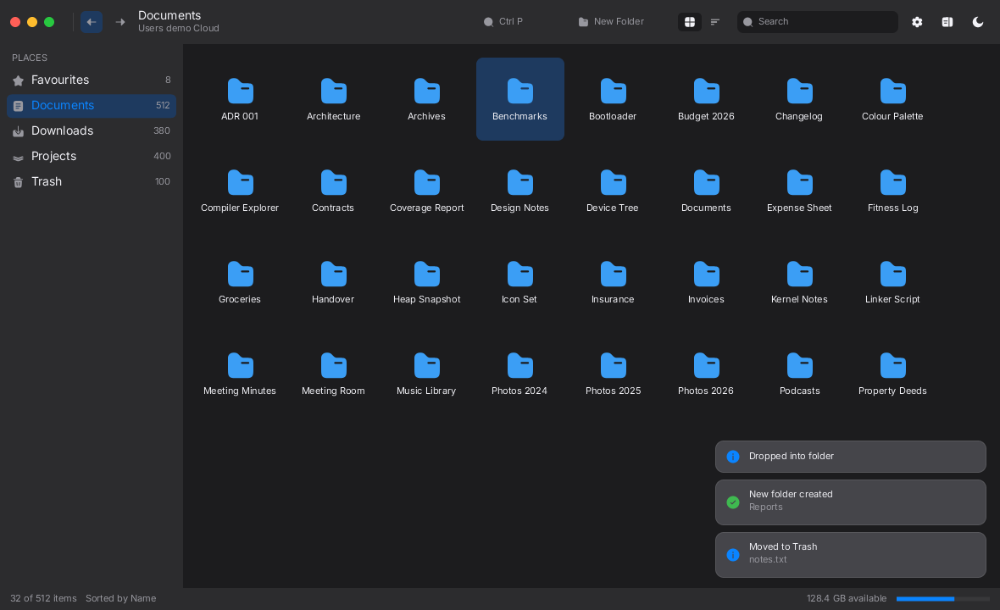
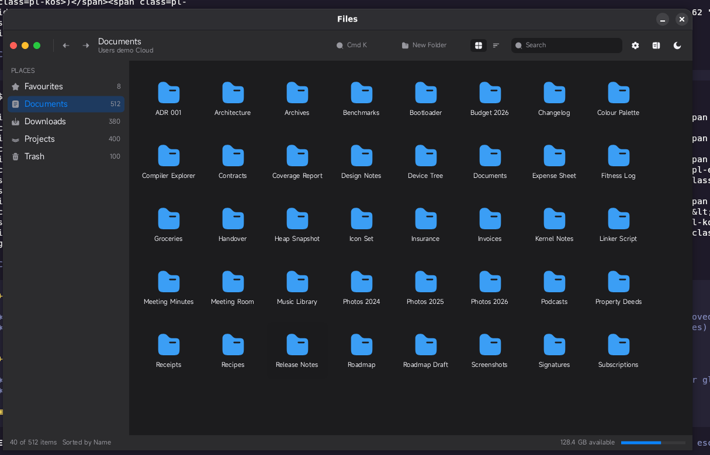

# mirui File Manager — a `no_std` validation suite

A modern, Apple-inspired file manager built entirely on
[`mirui`](https://crates.io/crates/mirui) 0.51, with the application logic compiled as
**`#![no_std]` + `alloc`**.

The point of this repository is not the file manager itself — it is a *proof* that mirui can carry
a real desktop-class application (custom chrome, a vector icon set, a virtualised list, context
menus, modal sheets, a command palette, drag and drop, reactive state, theming) before those
patterns get frozen into the OS app suite.


| | |
|---|---|
|  |  |
|  |  |
|  |  |
|  |  |

## What is in here

```
crates/fm          the application: #![no_std] + alloc, zero I/O, static fake filesystem
crates/sdl2-link   linker helper for the host targets
targets/desktop    std shell -> SDL2 window (interactive)
targets/snapshot   std shell -> headless render -> PNG (visual regression)
targets/bare       no_std shell -> bare-metal RISC-V image
assets/            the UI typeface (MIRX container) + licences
tools/             the SVG -> mirui path converter for the icon set
```

`crates/fm` owns the entire UI:

| Module | What it holds |
|---|---|
| `model` | The `#[model]` state: place, selection, view mode, palette, filter, history, drag, menu, sheet |
| `data` | 2048 fake files, built at compile time, sorted and filtered without touching a disk |
| `icons` | The [Solar](https://solar-icons.dev) icon set, converted into `path!` literals |
| `font` | A font provider that serves the typeface's exact-size rasters |
| `text` | The type scale |
| `theme` | The light and dark palettes, including custom `ColorToken`s |
| `ui` | The chrome: toolbar, sidebar, content, inspector, status bar |
| `ui/menu` | The context menu and the drag badge |
| `ui/dialog` | The modal sheets: new folder, rename, info, about, trash |
| `ui/palette` | The command palette |
| `ui/inspector` | The info panel with a preview |
| `ui/options` | The view options popover: icon size, hidden files, sort order |
| `sync` | The systems that bridge the model and the app: palette, drag tracking |

## The features

| | |
|---|---|
| **Finder-style shell** | Traffic lights, a unified toolbar, a translucent sidebar, an icon grid, a virtualised list, a status bar |
| **Real interaction** | Clicking, double clicking, right clicking, dragging, typing — all through mirui's hit testing |
| **Hover states** | Every tile, sidebar row, menu row and panel row has a real hover and press state, in both palettes |
| **Context menu** | Right click any file — not only the selected one: open, get info, rename, duplicate, move to another place, move to trash, put back |
| **Background menu** | Right click the empty space: new folder, sort by name / date / size, view options |
| **Modal sheets** | New folder, rename, get info, about and a trash confirmation, each with its own text field |
| **Command palette** | `Ctrl P`: sixteen commands, filtered as you type |
| **Drag and drop** | Drag a file onto a folder or a place in the sidebar; the target lights up and the file moves |
| **Scroll bars** | A thin overlay thumb on the trailing edge of every scrolling area, drawn by the app — mirui has no scroll bar widget at all |
| **Notifications** | A queue of notices with an icon, a title and a body, retired by a timer; every action reports through it |
| **Screenshot** | `Ctrl Shift S` captures the frame exactly as it is — an open sheet is captured untouched — and the host writes the PNG |
| **Controls** | Icon-size slider, hidden-files checkbox, sort segmented control, search field, view switcher, inspector toggle, theme toggle, progress bar, tab bar |
| **Two palettes** | Light and dark, switched live, with a system that keeps the app theme in step with the model |
| **Virtualised list** | Thousands of rows, only the visible ones exist as entities, cells recycle and rebind |
| **Real file operations** | Trash, restore, rename, duplicate, create folder, move — all of them change the listing |

## Running it

```bash
make build          # host build
make test           # 46 unit + interaction tests
make clippy         # lint gate
make snapshot       # writes artifacts/*.png
make desktop        # interactive window
make bare           # no_std RISC-V image
```

**Run it in release.** The software renderer is ten to forty times slower in a debug
build, and this app draws a few hundred vector paths per frame: `make desktop` and
`make snapshot` already pass `--release`.

or directly:

```bash
cargo build --workspace
cargo test --workspace
cargo run -p snapshot
cargo run -p desktop
cd targets/bare && cargo build --target riscv64gc-unknown-none-elf
```

The bare target is a **separate workspace** on purpose: the desktop target turns on mirui's `std`
feature and cargo unifies features per workspace, which would drag `std` into the `no_std` binary.

## The icons

Every glyph is a [Solar](https://solar-icons.dev) icon in the **Bold** style, converted from the
upstream SVG into a mirui `path!` literal by `tools/solar_to_mirui.py`: the vector data lives in the
program image, so there is no image decoding, no texture atlas and no file system access at run
time. The icons are drawn on Solar's 24x24 grid, which is also mirui's default icon view box.

Solar Icons by 480 Design, licensed under CC BY 4.0 — see `assets/LICENSES/`.

## The typeface

`assets/fonts/inter-*.mirx` are the Inter typeface (SIL OFL 1.1 — see
`assets/LICENSES/inter.txt`), one MIRX asset per weight, baked by
`tools/bake-fonts.sh` from the sources in `assets/fonts/src`. Each asset
carries a coverage raster for every size the interface draws at — 11–16 ppem
at 1x, 17–23 ppem at 1.5x, 22–32 ppem at 2x — plus a signed distance field
for everything in between.

A coverage raster is a blit, so it is cheap, and at its own size it is as
sharp as it can be. `mirui` picks a representation by the output ppem — the
logical size multiplied by the viewport scale — and accepts a coverage atlas
only when its design ppem matches exactly, so type stays crisp at 1x, 1.5x
and 2x instead of being resampled from a soft signed distance field.

Weights are semantic tokens, not hardcoded styles, so the OS suite can theme
them without touching widget code:

| token | weight | used for |
|---|---|---|
| `FontToken::Default` | Inter Regular | body text, labels, menu rows |
| `FontToken::Medium`  | Inter Medium | section headers, toolbar titles |
| `FontToken::Heading` | Inter SemiBold | sheet and dialog titles |

The remaining six weights (Thin … Black) are behind the `weights-all` cargo
feature because each weight is around two megabytes of atlas.

```rust
pub const SMALL: u16 = 11;  // icon grid labels, status bar, inspector details
pub const BODY: u16 = 14;   // list rows, sidebar labels, toolbar, menus, sheet bodies
pub const TITLE: u16 = 22;  // a sheet title
```

`tests/typeface.rs` keeps every string the UI can display inside the font's
coverage, so nothing renders as a silent gap, and asserts that `SMALL`,
`BODY` and `TITLE` are served by a coverage atlas at their exact pixel size
at 1x, 1.5x and 2x.

## What the tests prove

* `tests/data.rs` — the fake filesystem, the filter, the sorting, and the state transitions.
* `tests/features.rs` — the menus, the sheets, the command palette, drag and drop, the file
  operations, the inspector and the options.
* `tests/typeface.rs` — every string the UI can display is inside the font's coverage.
* `tests/interaction.rs` — a scripted surface feeds real pointer events into the application, and
  the tests assert that tapping the theme button, a sidebar row, a file tile and the view switch
  actually change the state. Real hit testing, real handlers, real reactive updates.

## Notes for the OS port

These are the mirui behaviours that shaped the code. They are worth knowing before the same
patterns are copied into the OS app suite.

* **A container has no intrinsic size.** Every panel, sheet and grid needs an explicit height,
  and a wrapping row cannot report how tall it became — the icon grid is a fixed number of columns
  whose height the model computes.
* **mirui's `LazyList` invalidates every retained cell on every frame**, which repaints the row's
  text and its vector icon: a list of a few hundred rows costs milliseconds per frame. The list view
  is therefore a plain scrolling column with a capped number of rows, and only the visible view
  builds its rows at all.
* **A composition argument is evaluated once**, when the tree is built. Anything that changes has
  to be read from the model *inside* the handler, not passed in.
* **A reactive binding should read a precise observation**, not a global counter: every binding
  that reads a counter re-runs on every change of that counter, and each re-run of a binding that
  touches a component dirties that widget.
* **`Button.normal_color` and `Text.text` are expensive to re-bind**: their property writes the
  component before it compares the value, so every re-run dirties the widget. `bg_color` compares
  first and is cheap. A tile that binds its selection colour through `Button.normal_color` makes
  every click repaint the whole grid.
* **A text widget consumes drag gestures** for its own caret selection, and a press event is
  delivered to the text rather than to the tile around it. A drag is therefore tracked from the
  pointer cursor in a system, not from the drag gesture.
* **The software backend caches no vector paths**: every scaled icon is re-rasterised on every
  repaint, so a full grid of icons is the dominant cost of a redraw.
* **A widget that binds a property re-dirties itself** when the property writes the component
  before it compares the value. `Button.normal_color` and `Text.text` do; `bg_color` does not. The
  hover is therefore painted by a view that reads the widget state and paints nothing at rest, and
  the selection stays a reactive `bg_color`.
* **`App::run` never blocks.** Without `FrameRateCapPlugin` the loop spins on a whole core and
  the window stops responding to the compositor.
* **`mirui` is pinned to `=0.51.0`**: the DSL surface is still moving.
