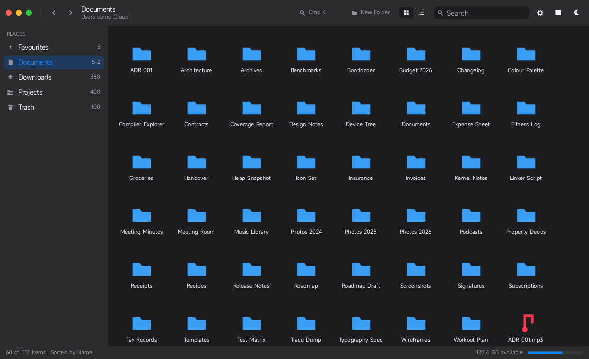

# mirui File Manager — a `no_std` validation suite

A modern, Apple-inspired file manager built entirely on
[`mirui`](https://crates.io/crates/mirui) 0.51, with the application logic compiled as
**`#![no_std]` + `alloc`**.

The point of this repository is not the file manager itself — it is a *proof* that mirui can carry
a real desktop-class application (custom chrome, vector icons, a virtualised list, context menus,
modal sheets, a command palette, drag and drop, reactive state, theming) before those patterns
get frozen into the OS app suite.



## What is in here

```
crates/fm          the application: #![no_std] + alloc, zero I/O, static fake filesystem
crates/sdl2-link   linker helper for the host targets
targets/desktop    std shell -> SDL2 window (interactive)
targets/snapshot   std shell -> headless render -> PNG (visual regression)
targets/bare       no_std shell -> bare-metal RISC-V image
assets/            the UI typeface (MIRX container) + licences
```

`crates/fm` owns the entire UI:

| Module | What it holds |
|---|---|
| `model` | The `#[model]` state: place, selection, view mode, palette, filter, history, drag, menu, sheet |
| `data` | 2048 fake files, built at compile time, sorted and filtered without touching a disk |
| `icons` | Hand-authored `path!()` vector assets on a 24x24 grid |
| `theme` | The light and dark palettes, including custom `ColorToken`s |
| `ui` | The chrome: toolbar, sidebar, content, inspector, status bar |
| `ui/menu` | The context menu and the drag badge |
| `ui/dialog` | The modal sheets: new folder, rename, info, about, trash |
| `ui/palette` | The command palette |
| `ui/inspector` | The info panel with a preview |
| `ui/options` | The view options popover: icon size, hidden files, sort order |
| `sync` | The systems that bridge the model and the app: palette, drop target |

## The features

| | |
|---|---|
| **Finder-style shell** | Traffic lights, a unified toolbar, a translucent sidebar, an icon grid, a virtualised list, a status bar |
| **Real interaction** | Clicking, long pressing, dragging, typing — all of it goes through mirui's hit testing and gesture recogniser |
| **Context menu** | Long press a file: open, get info, rename, duplicate, move to another place, move to trash, put back |
| **Modal sheets** | New folder, rename, get info, about, and a trash confirmation, each with its own text field |
| **Command palette** | `Cmd K`: fifteen commands, filtered as you type |
| **Drag and drop** | Drag a file onto a folder or a place in the sidebar; the target lights up and the file moves |
| **Controls** | Icon-size slider, hidden-files checkbox, sort segmented control, search field, view switcher, inspector toggle, theme toggle, progress bar, tab bar |
| **Two palettes** | Light and dark, switched live, with a system that keeps the app theme in step with the model |
| **Virtualised list** | Thousands of rows, only the visible ones exist as entities, cells recycle and rebind |
| **Real file operations** | Trash, restore, rename, duplicate, create folder, move — all of them change the listing |

## Running it

```bash
make build          # host build
make test           # 30 unit + interaction tests
make clippy         # lint gate
make snapshot       # writes artifacts/*.png
make desktop        # interactive window
make bare           # no_std RISC-V image
```

or directly:

```bash
cargo build --workspace
cargo test --workspace
cargo run -p snapshot
cargo run -p desktop
cd targets/bare && cargo build --target riscv64gc-unknown-none-elf
```

The bare target is a **separate workspace** on purpose: the desktop target turns on mirui's `std`
feature, and feature unification would otherwise drag `std` into the `no_std` binary.

## What the tests prove

* `tests/data.rs` — the fake filesystem, the filter, the sorting, and the state transitions.
* `tests/features.rs` — the menus, the sheets, the command palette, drag and drop, the file
  operations, the inspector and the options.
* `tests/typeface.rs` — the typeface only carries a subset of ASCII; every string the UI can
  display is checked against the font's coverage so nothing renders as a silent gap.
* `tests/interaction.rs` — a scripted surface feeds real pointer events into the application, and
  the tests assert that tapping the theme button, a sidebar row, a file tile and the view switch
  actually change the state. Real hit testing, real handlers, real reactive updates.

## Fonts

`assets/misans_ui.mirx` is the MiSans UI typeface packaged in mirui's MIRX asset container
(MiSans is free for commercial use — see `assets/LICENSES/`). mirui only loads fonts from MIRX
containers; the built-in fallback is an 8x8 bitmap that is unusable for a real UI.

The asset carries a **reduced character set** (` !#&,0-9:;?@A-Za-z`): no dash, slash, percent sign
or brackets. That is why the chrome says `Users demo Cloud` instead of a path, and why folders
have no size. `tests/typeface.rs` keeps that honest.

## Notes for the OS port

* The application crate never touches the platform: it is a pure function of the state model and
  the data table. A target supplies a `Surface`, a font and the input events.
* Vector chrome is `path!()` literals in the program image — no image decoding, no texture atlas.
* Selection lives in the state model keyed by file id, never in the recycled list cell.
* mirui containers have **no intrinsic size**: every panel, sheet and grid needs an explicit
  height, and a wrapping row cannot report how tall it became. The icon grid is therefore a fixed
  number of columns whose height the model computes.
* A composition argument is evaluated **once**, when the tree is built. Anything that changes has
  to be read from the model inside the handler, not passed in.
* `mirui` is pinned to `=0.51.0`: the DSL surface is still moving.
